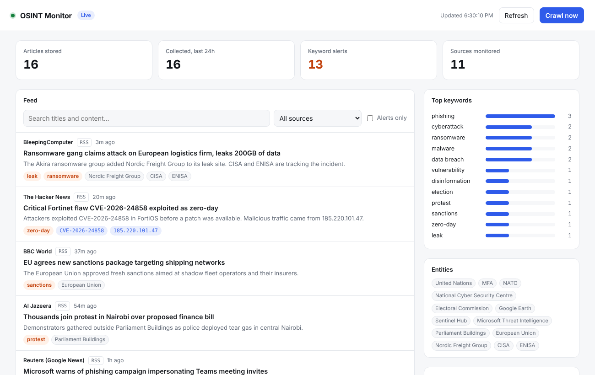

# OSINT Monitor

A self-hosted news and forum monitoring pipeline. It crawls news sites, Reddit, Hacker News and public Telegram channels, flags items that match your keywords, extracts entities and indicators (CVEs, IPs, emails), and serves everything through a FastAPI search API and a live dashboard.

**Stack:** Python 3.12 · asyncio · httpx · Playwright · BeautifulSoup · FastAPI · Kafka · PostgreSQL · MinIO · Docker



## Architecture

```
                 ┌──────────────┐  POST /api/crawl   ┌────────────────┐
  Browser ─────▶ │  FastAPI     │ ─────────────────▶ │ Kafka          │
  dashboard      │  (api)       │                    │  osint.jobs    │
                 └──────┬───────┘                    └───────┬────────┘
                        │ reads                              │
                        ▼                                    ▼
                 ┌──────────────┐                    ┌────────────────┐
                 │ PostgreSQL   │                    │ crawler        │  scheduled + on-demand
                 │ articles,    │                    │ httpx / PW     │  per-host throttling,
                 │ crawl_runs   │                    └───────┬────────┘  retries, browser fallback
                 └──────▲───────┘                            │ new items
                        │ upsert                             ▼
                 ┌──────┴───────┐   consume          ┌────────────────┐
                 │ worker (x2)  │ ◀───────────────── │ Kafka          │
                 │ enrich + save│                    │  osint.raw     │
                 └──────┬───────┘                    └────────────────┘
                        │ raw JSON                   failures ─▶ osint.dlq
                        ▼
                 ┌──────────────┐
                 │ MinIO        │
                 └──────────────┘
```

- **crawler**: crawls every source on a schedule, and on demand when the API publishes a job. It dedups against Postgres plus an in-memory LRU, then publishes only new items to `osint.raw`, keyed by URL hash.
- **worker**: consumes `osint.raw` in batches, matches keywords, extracts entities, CVEs and IPs, archives the raw payload to MinIO and upserts into Postgres. Offsets are committed only after the batch is saved, and bad messages go to `osint.dlq`. Run as many replicas as you have partitions.
- **api**: search and filter endpoints, stats, source health, crawl triggers, and the dashboard at `/`.

## Anti-bot handling

The fetcher (`app/crawlers/fetcher.py`) is built to stay unblocked:

- per-host throttling with random jitter, so no domain gets hammered
- exponential backoff on 429 and 5xx responses, honouring `Retry-After`
- automatic fallback to headless Chromium (Playwright) when a site returns 401 or 403 to plain HTTP, with a realistic viewport, locale and `navigator.webdriver` hidden
- `render: True` on a source forces browser mode for JS-heavy sites

Build with `INSTALL_PLAYWRIGHT=1` to enable the browser tier.

## Run it

```bash
cp .env.example .env
docker compose up --build
```

- Dashboard: http://localhost:8000
- API docs: http://localhost:8000/docs
- MinIO console: http://localhost:9001 (minioadmin / minioadmin)

The first crawl starts as soon as the crawler is up. Use **Crawl now** in the dashboard to trigger another one.

### Quick local demo (no Docker, no crawling)

```bash
pip install -r requirements.txt
export DATABASE_URL=sqlite+aiosqlite:///./osint.db
python -m scripts.seed_demo
uvicorn app.api:app --reload
```

### Tests

```bash
pytest -q
```

## API

| Method | Path | Description |
|---|---|---|
| GET | `/api/articles?q=&keyword=&source=&alerts_only=&limit=&offset=` | Search and filter collected items |
| GET | `/api/articles/{id}` | One item with full content |
| GET | `/api/stats` | Totals, top keywords, entities and CVEs |
| GET | `/api/sources` | Each source with its last run status |
| POST | `/api/crawl` `{"source": "*"}` | Queue a crawl of all sources, or one by name |
| GET | `/health` | DB and Kafka status |

## Configuration

Sources live in `app/sources.py`. Add an entry with `type` set to `rss`, `reddit`, `hackernews` or `telegram`. Keywords, crawl interval, concurrency and per-host delay are set in `.env`.

## Project layout

```
app/
  api.py              FastAPI app and dashboard
  crawler_service.py  scheduler and on-demand job runner
  worker.py           Kafka consumer: enrich, archive, store
  crawlers/
    fetcher.py        throttled httpx client with retries and Playwright fallback
    parsers.py        RSS / Reddit / HN / Telegram parsers (pure functions)
    base.py           source dispatch
  enrich.py           keyword matching, entity and IOC extraction
  db.py               SQLAlchemy models and upsert helpers
  kafka.py            producer and consumer factories
  storage.py          MinIO raw archive
  sources.py          monitored sources
  static/index.html   dashboard
scripts/seed_demo.py  sample data for offline demos
tests/                parser and enrichment tests
```

## Notes

Crawl only public pages, respect each site's terms of service and robots.txt, and keep request rates low.
